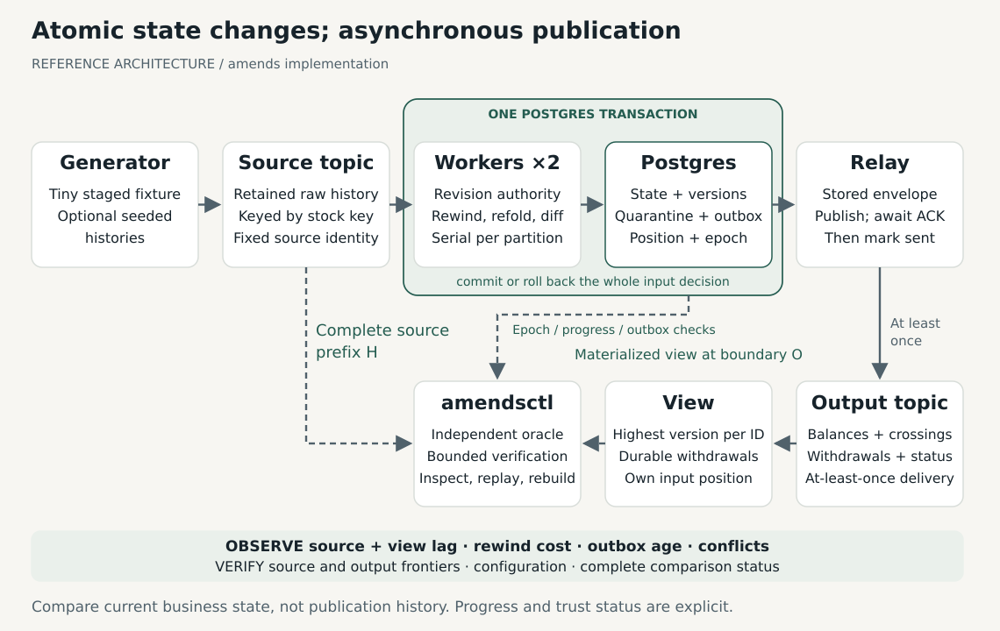

# Design

[Semantics](semantics.md) defines the contract; the [technical guide](technical-guide.md) maps this design to code.

## 1. Design intent

When an earlier stock movement changes, already-published balances and alerts may be wrong. amends repairs those results incrementally and keeps a separately implemented full-history calculation available to check them. Choosing which revision applies is **source authority**; it follows revision numbers, not arrival order.

The worker recalculates balances and alerts from the earliest affected day forward. That portion of history is the **affected suffix**, and recalculating it is a **refold**. Comparing the new results with previously committed results (the **diff**) identifies updates and withdrawals. Inventory receipts add units, issues remove units, and a daily close is the balance after that day's active movements. Alerts record a transition from a previous close at or above the threshold to a close below it, as worked through in [evaluation](evaluation.md#the-story-to-look-for).

Processing must survive a failure between saving a correction and publishing it. PostgreSQL therefore commits the intended publications with the processing state in a **transactional outbox**; a separate relay delivers them later. Consumers keep the latest results in a **materialized view**. Withdrawals retain a deletion version, or **tombstone**, to stop delayed older messages from recreating removed results.

Workers can overlap during reassignment. The database records an ownership generation (**epoch**) and refuses old-owner commits after a newer epoch is installed; this is **fencing**. It also stores the next offset to process, the exclusive **source frontier**. The view has a separate frontier for published output. These are broker coordinates, not business-record counts. A transaction already holding the ownership row lock may finish before the replacement epoch installs; Kafka reassignment is not that database boundary.

[](media/architecture.svg)

The worker-to-Postgres arrow represents one transaction boundary. The Postgres-to-relay-to-view path is asynchronous, with possible repeated delivery; it is not one distributed transaction. The verifier's **independent oracle** reconstructs applicable revisions, balances, and alerts from the full retained source history and compares them with the downstream view. It does not use the worker's computed answers, although shared decoding and representations can still cause shared defects.

## 2. Component responsibilities

| Component | Owns | Does not own |
| --- | --- | --- |
| Generator | Synthetic configuration, fixture loading, seeded arrival schedules | Production ingestion or business authority policy |
| Source topic | Retained transport history and source coordinates | Choosing authoritative revisions |
| Workers | Partition lifecycle, revision decisions, refold and output diff | Delivery of uncommitted output |
| Postgres processing store | Atomic state, progress, epochs, quarantine, versions, outbox | Atomic downstream application across topics |
| Relay | Repeated delivery of unchanged committed envelopes | Allocating replacement versions on retries |
| Output topic | Transport of versioned business and trust-status messages | Deduplicated current business state |
| View service | Durable highest-version materialization and its input frontier | Undoing an external business action |
| amendsctl | Inspection, bounded verification, controlled replay and isolated rebuild | Inventing source authority or bypassing conflicts |

The implemented `inspect -format html` dashboard renders live observations as a static local page and does not certify a verification boundary. PostgreSQL-only diagnostic review exposes rejected records and current/superseded canonical conflicts without changing state. The last instrumented processing decision is stored with its source frontier and displayed alongside progress; pure refold work and client-side lock/precommit timings remain distinct from full storage-call attempt logs. Committed cumulative counts and the latest 32 samples per partition are available in the same inspection report. Prometheus/Grafana and long-term charting are not running dependencies. Metric continuity is not itself a correctness dependency; structured verification reports remain usable independently.

## 3. Storage model

The [SQL schema](https://github.com/sorrell-consulting/amends/blob/main/migrations/001_initial.sql) combines revision evidence, authority, status, balances, and alerts in a serialized per-key state row, with separate relational progress, outputs, outbox, quarantine, and view tables. The source manifest binds a topic name to the broker UUID in immutable configuration and requires retained starts of zero. Migration 002 adds immutable output-topic binding and exact view protocol diagnostics; migrations 003 and 004 add committed processing measurements and bounded aggregate/history collection. The [delivery guide](output-delivery.md) documents adoption checks and restart constraints.

We use PostgreSQL to commit processing state and authoritative source progress in one transaction. Embedded state with a changelog could reduce database interaction, but would also need restoration and progress coordination. We process records serially within each partition to avoid tracking partially completed offsets across concurrent keys. A long transaction can delay other keys and ownership changes on that partition; see [processing costs](#processing-costs).

| Logical relation | Required durable content |
| --- | --- |
| `namespaces` | Immutable config, ledger origin, schema/code identity, source incarnation and start vector, partition mapping |
| `partition_state` | Namespace, source partition, current epoch, authoritative next offset, next emission sequence |
| `revision_evidence` | Key, TxnID, revision, canonical candidate payloads and source references, superseded conflict evidence |
| `transactions` | Current highest-revision resolution: active, cancelled, or ambiguous |
| `key_state` | READY/BLOCKED and unresolved authority references |
| `daily_balances` | Current sparse per-key daily closes used for rewind |
| `output_state` | Per-ID last derived payload/presence and durable version, including withdrawals |
| `outbox` | Immutable namespaced envelope, source cause, partition emission order, acknowledgement state |
| `quarantine` | Raw record or retained reference, exact rejection reason, source coordinates |
| `view_state` | Highest durable version and visible payload or deletion marker per output ID |
| `view_progress` | Durable output-consumer next offsets |

All tables are namespaced. Use constraints for uniqueness, nonnegative counters where appropriate, positive revisions/versions, and valid state combinations. Never overload SQL NULL to mean both “not yet seen” and “withdrawn.” Domain errors and concurrency conflicts must remain distinguishable.

We retain revision candidates so an equal-revision conflict can be diagnosed even after other input has arrived. Cleanup of evidence, output tombstones, or configuration would require its own protocol and is not included.

Processing state and view state may share a local Postgres server in separate schemas. The authority model remains separate: the verifier's oracle consumes source history, and the value being checked is the view. Sharing a server is not a high-availability design.

## 4. Worker transaction protocol

The worker holds the partition-state row lock across each processing decision. PostgreSQL's `SELECT ... FOR UPDATE` prevents conflicting updates/locks until the transaction ends; this is the database behavior the protocol relies on. See reference R1 in [references](references.md).

For each record:

```text
receive record under an active partition assignment
begin database transaction
lock partition_state for this namespace and source partition
validate ownership epoch and expected durable source progress
read required mutable state under the same transaction
classify and persist input evidence
  malformed -> durable quarantine
  stale / duplicate -> no business changes
  conflicting highest authority -> block key and retain evidence
  unambiguous change -> update authority and refold/diff when allowed
persist business changes, output versions, and outbox intent
advance authoritative source frontier consistently with the consumed record
commit the whole decision
```

The implementation may validate immutable record syntax before opening the transaction, but rejection evidence and progress still commit together. Mutable authority or output state must not be read optimistically outside the lock and then committed without revalidation.

Epoch installation takes the same row lock. An old transaction already holding the lock may finish first. Once the new epoch has committed, an older token must fail before committing any part of its decision. Use deterministic lock ordering and bounded database timeouts; do not perform broker publication or wait for a human while holding the transaction open.

A real rebalance adapter must cancel stale assignment work and park revoked workers. A database epoch cannot compensate for an obsolete callback that is incorrectly allowed to claim a new epoch. The [worker suite](source-worker.md#tests-and-limits-of-the-evidence) exercises the database and lifecycle integration.

### Pinned client findings

The [source adapter](source-worker.md) uses **franz-go v1.22.1**, Go 1.27.2, and the local **Redpanda v26.2.3** broker over its host listener. Its configuration uses classic consumer groups with the eager range balancer, explicit topic retention, disabled auto-commit, and synthetic records. Eager rebalancing gives a simple revoke/reassign boundary at the cost of moving unaffected partitions. Cooperative and server-side assignment require different lifecycle handling and are outside the tested configuration. The following observations are specific to the pinned client and broker:

| Check | Observed result |
| --- | --- |
| Assignment and external seek | `OnPartitionsAssigned` preceded `AdjustFetchOffsetsFn`. An external frontier of 1 overrode a broker group commit of 4; the first returned record was at offset 1. |
| Unavailable position | Requesting offset 100 in a partition ending at 1, with `ConsumeResetOffset(NoResetOffset())`, returned `OFFSET_OUT_OF_RANGE` without records. |
| Processing and rebalance | After `PollRecords(ctx, 1)` with `BlockRebalanceOnPoll`, the callback-blocked signal arrived before revocation. `AllowRebalance` released revocation and the second member fetched. The callback's client context remained live. |
| Delayed offset load | Revocation waited for the offset-adjustment callback; the session context alone could not release the load. Independent cancellation released it. Returning `context.Canceled` stopped group management, requiring explicit consumer retirement outside the callback. |
| Offset gaps | A read-committed scan returned visible records at offsets 0 and 4 around an aborted transaction whose data was at 2. Two visible records did not imply next offset 2; the coordinate after the second record was 5. |

The pinned source serializes offset-adjustment and revocation callbacks. Offset loading therefore needs an independent cancellation/deadline path; it cannot rely solely on session cancellation. Returning `context.Canceled` can terminate group management, so recovery explicitly retires the client from outside its callbacks. Callback contexts and serialization are described in the [pinned API/source references](references.md) (R3); a live client context is not evidence of current partition ownership.

Keep offset adjustment limited to obtaining and validating the external frontier. Do not launch detached epoch installers from it. The adapter must invalidate its assignment token on revoke, loss, or shutdown, cancel/join outstanding assignment work, and serialize token validation with any attempt to install ownership. A context check followed by an unguarded asynchronous claim leaves a race. Unknown claim outcomes require durable re-observation, just like unknown processing commits.

Use an exact frontier with `WithEpoch(-1)` when no compatible broker leader epoch has been persisted; a broker leader epoch is distinct from the database ownership epoch. Validate topic incarnation and retained boundaries before consumption. The worker suite rejects deleted required history, changed topic incarnation/partition count, and a database frontier beyond the end. Poll release must occur on success and failure paths, with processing bounded below the rebalance timeout.

The gap check exercises broker coordinates, not a decision to accept arbitrary transactional input. Source and oracle visibility must agree. Advancing through a trailing run of control/filtered records to a captured end vector still needs a validated adapter rule; neither record count nor a high-watermark alone proves processing completion. The worker suite exercises eager rebalances and database fencing. It also checks cancellation of obsolete assignment work and recovery when a database operation's acknowledgement is lost. Abrupt member loss, cooperative/server-side groups, and the complete verifier remain outside that suite.

### Unknown commit outcome

Test both outcomes of a lost commit acknowledgement. If the transaction committed, durable progress and output intent exist and re-reading must not produce another semantic transition. If it aborted, none of that decision exists and the record can be processed normally. Recovery re-reads the database after reconnecting; it must not infer rollback from a timeout.

Store the authoritative source position with the state. Kafka's design documentation discusses coordinating an external consumer position with external output; amends chooses a database-local state/progress transaction and a separate outbox rather than claiming a cross-system atomic transaction (R2).

## 5. Incremental state and output repair

For an ordinary revision, the worker compares old and new active contributions, computes the earliest affected day, restores the latest earlier close, and recomputes the suffix. Deletion of the only transaction on a day removes the balance row. Crossing facts are derived from daily closes, not from transaction-by-transaction intraday motion.

The diff compares the newly derived semantic outputs with committed `output_state`. It emits only changed facts and required withdrawals. The table represents outputs whose intent was committed, not proof that the view has already received them.

An unresolved highest revision blocks computation for its key. Other arrivals for that key are recorded, but its previous business outputs are frozen and visibly uncertified. Once the key becomes unambiguous, a full key refold avoids having to reason about every suspended incremental rewind. Repair messages precede the READY status message in that key's partition order.

Choosing a conflicting value by arrival order or hash would invent source authority. Silently excluding the conflict would conceal an uncertified result. Visible BLOCKED/READY status preserves that distinction while allowing unrelated keys to continue.

A blocked status is a control-plane trust signal, not a substitute for displaying the view's progress. Because downstream changes are asynchronous, a live reader can temporarily see an old status or partial repair. The complete verification boundary is the point at which the contract compares the whole business result.

### Why daily closes and sparse days?

We use daily-close crossings to match the `(stock key, crossing day)` alert identity. Intraday crossings can occur several times per day and would require finer identities and ordering rules. A crossing records a historical transition that remains valid under current authority; a later receipt does not retract it. The opening balance supplies the first activity day's predecessor, so starting below the threshold does not itself create a crossing.

Balance facts exist only for days with active transactions, and balances carry implicitly across gaps. Dense daily output would need a reporting horizon and synthetic rows for inactive days. Sparse output keeps the example small but requires a withdrawal when a day's last active transaction disappears. Equal-time transaction order does not affect exact daily sums or crossings, so reversing the TxnID tiebreak is equivalent for this business projection. See [daily-close semantics](semantics.md#s5-daily-balances-and-crossing-alerts).

### Why refold the suffix?

For a quantity-only amendment in this additive ledger, propagating a constant delta through later balances could avoid recalculating daily totals. We use suffix refolding because one repair rule also handles transactions moving between days, cancellations that remove activity days, and alerts whose crossings change. The previous close supplies the starting balance; the worker derives the remaining daily closes and crossings under current authority, then compares them with committed output intent.

This keeps the repair path easy to inspect and test across revision types, at the cost of efficiency for deep corrections. Delta propagation or indexed aggregates could reduce some work, but would need to preserve sparse-day withdrawals, alert payloads, authority conflicts, and checked arithmetic. We have not implemented those optimizations.

### How much history needs repair?

The three-day introduction corrects Day 1, so all three closes need recalculation. A later correction can preserve a much longer prefix. For a history with activity on each of 2,000 consecutive days, the inclusive repair ranges are:

| Calculation | Activity days requiring derivation |
| --- | ---: |
| Correct Day 10 | 1,991 |
| Correct Day 1,990 | 11 |
| Reconstruct the full history | 2,000 |

These are calculated ranges, not measured performance. Full-history reconstruction determines authority from all retained source revisions and derives every activity day's result. Ordinary incremental repair reuses closes and alerts before the earliest changed day. Resolving a blocked key instead requires a full key refold.

The opt-in [repair-locality example](https://github.com/sorrell-consulting/amends/blob/main/test/scenarios/repair_locality_test.go) executes the existing Go fold, output diff, memory view, and independent oracle. Run it from the repository root:

```sh
make test-locality
```

Each case has one transaction per day, opening inventory of 100, and a threshold of 60. Most movements have quantity zero and still count as activity. An issue of 50 on the selected day, an issue of 20 the next day, and a receipt of 50 the day after produce closes of 50, 30, and 80. Amending the first issue to 30 changes those closes to 70, 50, and 100, with the final close carrying through the remaining activity days. Each case starts from its own baseline, folded record by record and then materialized once.

| Correction | Observed `from_day` | Observed `rewind_days` | Observed `refolded_records` | Balance updates | Alert withdrawals / raises | Business envelopes |
| --- | --- | ---: | ---: | ---: | ---: | ---: |
| Day 10 | 2026-01-10 | 1,990 | 1,991 | 1,991 | 1 / 1 | 1,993 |
| Day 1,990 | 2031-06-13 | 10 | 11 | 11 | 1 / 1 | 13 |

`from_day` is the earliest affected UTC day. `rewind_days` is the calendar distance to the previous last balance day, excluding the starting day; it is not a count of activity rows. `refolded_records` counts authoritative active transactions selected for derivation. The envelope counts come from the actual diff and exclude key-status messages. Here every affected close changes, and the original alert is withdrawn while the next day's alert is raised.

Both cases also cancel the only movement on Day 2,000. The fold selects zero active suffix records, yet the diff emits one balance withdrawal and the view retains deletion version 3. The final row disappears while the preceding balance carries forward. Baseline, correction, and cancellation results are each checked against separately stated arithmetic expectations and the independent full-history oracle.

This execution measures semantic work in memory. It exercises no SQL transaction, broker, or durable publication boundary and reports no elapsed-time improvement. The smaller suffix reduces derivation work; the costs below still apply.

### Processing costs

Derivation is only part of processing a correction. `fold.Apply` clones per-key evidence and projections, scans identities to establish trust, and scans active transactions to select the suffix. It also walks prior balances and alerts to preserve the prefix. The diff examines desired and previously committed outputs. These steps still inspect or copy state outside the repair range.

Persistence adds state serialization, database reads and writes, output versions, and outbox intent. Later relay delivery and view application add their own work and waiting. Fewer refolded records therefore do not imply proportionally lower CPU use, memory use, transaction duration, or end-to-end latency.

A deep rewind can touch many rows and hold the partition lock for a long transaction. Other keys on that partition wait behind it; ownership transfer may also wait for that lock. The [implemented processing measurements](verification.md#committed-processing-measurements) expose the last committed rewind depth, refolded-record count, changed-output counts, and client lock/precommit elapsed time with progress. Source-worker logs time the complete storage call and retain unknown/error observations. Lock acquisition includes more than server wait, and suffix record counts exclude the state-copy/authority-scan/output-read overhead. Cumulative committed counts/timing sums and the latest 32 samples are retained per partition. Earlier collection history is unknown; long-term percentiles and isolated server wait accounting are not implemented.

The reference design keeps those costs visible. Representative workload measurements would justify moving to embedded state, per-key concurrency, batching, or richer snapshots; each alternative would require new progress and recovery reasoning.

## 6. Outbox and relay

Allocate a per-partition emission sequence under the worker's partition lock and commit it with the outbox row. The relay operates serially within each partition, selecting the earliest pending committed envelope. One relay service per namespace preserves this order; automatic relay failover is outside the operating model.

Publish the exact stored envelope, await acknowledgement, and mark it sent. If the acknowledgement is missing, retry that same version and content. A retry does not call the business diff again. A transaction that rolls back must leave no publishable envelope.

Keep acknowledgement information sufficient to explain publication progress and establish the verification drain. Never mark an output delivered merely because a send function was called, and never use an empty in-process queue as evidence that the durable outbox drained.

The implemented [relay runner](output-delivery.md) uses exact committed bytes and rereads durable receipts after unknown SQL outcomes. Its session advisory lock prevents duplicate healthy starts but does not fence an already in-flight broker request after session loss. Stop and join an old runner before replacement; the bounded verifier requires a clean stopped-relay handoff and holds its service guard before observing the output end.

The durable quarantine table is the operator-facing source. Any additional quarantine notification would need to use the outbox so its intent commits with the rejection and source progress.

## 7. Durable view materialization

The implemented view is a small consumer with its own Postgres transaction. It compares a received output version with the stored version, conditionally updates the business payload or deletion marker, and advances its output-consumer frontier atomically.

Withdrawn rows remain as invisible tombstones with versions. Equal-version conflicting content is a protocol error; the consumer does not guess which message is right. An older valid envelope is ignored, but its consumption decision is still durable.

Physically deleting a withdrawal's version would allow an older delayed message to recreate the fact. The reference implementation retains these deletion versions indefinitely. Change-attribution fields identify the source assertion that caused an output revision; full reconstruction still needs retained source history and immutable configuration. Applying a withdrawal does not undo an external action taken from an earlier result.

The view uses SQL tables queried by `view-show`; `inspect` includes progress, outbox age, offset distances, and source diagnostics. Both are live observations; use the [bounded verifier](verification.md) for comparison. It must expose enough information to explain presence, current value, version, trust status, and progress. Version monotonicity alone does not make a group of row updates appear atomically.

## 8. Independent oracle

The oracle implements the source contract independently of the incremental path: read a complete raw source prefix; independently validate and group candidate assertions; choose the unique highest canonical revision per identity; reject or qualify ambiguity; aggregate active quantities by key/day; calculate cumulative closes; derive daily crossings.

The oracle may share domain types and a basic wire decoder, but not the incremental revision resolver, fold, diff, applied-state tables, or stored rewind snapshots. Authority equality and day derivation deserve separate expected-value tests so a shared decoder defect is not invisible to both implementations.

Hand-calculated expected fixtures validate the oracle itself. The core property is then a three-way relationship on small named cases: specified expected values, independent oracle, and incremental view. Generated cases broaden coverage without replacing those independently stated examples.

We use `math/big.Int` accumulation and full-history grouping in the oracle to keep its calculation straightforward and separate from incremental repair. The incremental fold cancels opposite-signed quantities before checked int64 accumulation, so a representable daily close does not fail solely because of an intraday subtotal. See the [assessment](assessment.md#3-correctness-evidence-still-has-limits) for the limits of these checks.

## 9. Bounded verification protocol

Correctness requires comparing the same history on both sides. Input must be stable, processing and delivery must reach the required positions, and the relay must be drained, stopped, and joined. This controlled stillness is **quiescence**. **Bounded verification** checks the resulting fixed source/output boundaries within a time budget; zero lag or an empty outbox alone is insufficient.

The implemented [verifier](verification.md) acquires the owned source loader guard and the operator-stopped relay guard, captures a fixed source end vector, waits for worker progress, requires a drained outbox, captures the output end vector, and waits for the view. It compares a stable view snapshot with an independent source scan. For independently operated pipelines, the operator drains and stops/joins the relay. The [showcase runner](showcase.md) automates that handoff for its own finite pipeline; it does not adopt arbitrary processes. The [semantics](semantics.md), S10, defines exact statuses.

The report must distinguish unavailable history, incomplete materialization, authority ambiguity, and actual drift. A drift report identifies the first differing key/day or alert and the relevant source coordinates, not merely a total mismatch count.

For the combined incomplete-boundary/conflict case, the overall report is INCOMPLETE with known conflict diagnostics. Affected keys retain their BLOCKED trust status. Once the complete boundary is established, unresolved authority yields overall BLOCKED, as specified in S10.

The default demonstration uses a dedicated namespace and controlled producer to establish that fixed history. This is sufficient for its finite correction and recovery runs.

### Verification while processing continues

A continuously operating pipeline needs another way to hold the comparison history fixed. If the oracle reconstructs source prefix H while the view incorporates later records, comparing those answers can report normal progress as drift. The current unversioned view cannot recover an earlier business projection simply by selecting an old source offset.

An extension would need stable lineage from source positions through committed output intent, publication, and downstream application. It would identify a consistent cut: every decision through H has committed, all output belonging to those decisions has been published and applied, and the compared view excludes later decisions. The cut must cover each relevant partition and preserve topic incarnation and configuration identity. A watermark or zero lag alone cannot establish that relationship.

Historical view versions could retain the projection for that cut while newer changes continue. Alternatively, a coordinated snapshot or compatible checkpoint could preserve source positions, processing/output progress, and view state together, with retained history sufficient for reconstruction. Either strategy needs explicit reconciliation positions and evidence of complete application, including withdrawals and trust-status changes. A database MVCC snapshot freezes what is visible when it starts; if that state already includes later source decisions, MVCC alone does not make it the view of H.

These are architectural extensions, not v1 features. Their consistency and retention rules would need separate implementation and failure tests. The current verifier obtains the same-history guarantee by controlling source production and the relay handoff, then waiting for the view at the captured output end.

Preserve the source history. Kafka documents retention and compaction as mechanisms that can remove records; their correct configuration is a prerequisite for this example's full-history oracle (R2, R4). Validate equivalent behavior on the pinned local broker; Kafka documentation alone does not establish Redpanda configuration parity.

## 10. Controllable failure boundaries

Pure fold/diff code has no I/O. Worker, relay, and view orchestration expose the effects and observations that recovery decisions need. The [delivery scheduler](delivery-simulation.md) drives production `delivery.Stepper`; the [worker scheduler](worker-simulation.md) drives production `worker.Lifecycle`. Both use controlled memory I/O and logical retry waits. The `sim` command uses a separate serial transaction model.

### Minimal operation boundaries

| Actor / step | Inputs and observable result |
| --- | --- |
| Assignment | Partition and local assignment token; claim/read returns durable epoch and next offset, definite failure, or unknown outcome. An invalidated token cannot start another claim. |
| Worker decision | Record coordinates, expected epoch/frontier, and pure decision; commit atomically changes the S8 state and returns a receipt, definite abort, or unknown outcome. |
| Commit recovery | Re-read durable ownership/progress and decision evidence before choosing resume, retry, or retirement. Never allocate a second semantic transition from an acknowledgement timeout. |
| Relay attempt | Read earliest pending immutable envelope; publication returns acknowledged coordinates, definite non-acceptance, or unknown acceptance. Only acknowledgement permits marking sent. |
| View decision | Envelope and expected view frontier; atomically apply version/tombstone rules and progress with the same three commit observations. |
| Boundary observation | Read retained starts, topic incarnation, broker ends, and durable worker/relay/view progress separately; a fetched position is not a processing receipt. |

The failure model separates **durable outcome** from **caller observation**. For a lost commit reply, the harness chooses whether the transaction committed or aborted, while the caller receives an unknown result. An ordinary I/O error does not establish rollback. Similarly, broker acceptance followed by a lost reply leaves an unchanged outbox envelope eligible for redelivery. Transport retries reuse that envelope and its version.

Production retry loops use bounded attempts, cancellable waits, and real operation deadlines. Schedulers supply logical waits and explicit atomic effects/unknown observations. Exhaustion parks or reports the actor; it never advances a frontier. An obsolete callback cannot acquire fresh ownership, and a lost claim reply requires durable re-observation.

These are bounded serial schedules, not a generic concurrent event engine. Arbitrary concurrent completions and logical deadline-expiry schedules are outside their supported model. Real PostgreSQL lock ordering and actual broker callbacks remain separate tests. The [mutation campaign](mutation-testing.md) checks whether named semantic assertions detect specific guard removals in isolated copies; it does not add runtime fault modes.

## 11. Recovery boundaries

Ordinary restart seeks to durable progress and preserves output versions. Controlled replay uses intact state and a separate scan cursor over already-processed retained input. It is an idempotency/re-delivery exercise, not state reconstruction.

The [operator commands](replay-rebuild.md) default to dry runs and require `--execute --quiesce` for execution. PostgreSQL replay locks the partition, rechecks epoch/frontier and retained evidence, and commits only a higher ownership epoch on execution. Rebuild creates a fresh namespace and output binding, reads the same complete retained source through production worker lifecycle code, drains its relay/view, and invokes independent bounded verification. Producer session guards use source incarnation so both namespaces exclude the same cooperative writers; relay/view guards remain namespace-specific. Failed or uncertain destination creation is reported and retained, never silently adopted.

Rebuild reads the full required history into fresh processing and output namespaces. This prevents version collisions and stale-message resurrection across runs. Rebuilt publication histories and versions may differ while business values agree. The old namespace remains intact until an explicit local cleanup; no live consumer cutover is implied. Reusing an output namespace would require an output-generation and consumer-cutover protocol that v1 does not provide.

A restored database backup would require compatible source availability, source coordinates, configuration, and output-version history. Backup restore and checkpoint support are outside the implemented recovery model.

## 12. When this pattern does and does not fit

The example fits a source that supplies stable transaction identities, ordered revision authority, complete replacement records, and enough retained history to reconstruct derived state. It is useful when consumers can accept explicit revisions to previously published information.

It does not directly solve patch-only feeds with missing revisions, ambiguous source authority, irreversible external actions, global inventory constraints, real-time intraday alerting, or bounded-latency processing under arbitrary deep corrections. Those require different or additional contracts. In some workloads, a well-operationalized periodic batch remains the simpler choice.

We implement processing, state management, and recovery directly so readers can inspect and test these mechanisms. That serves this reference implementation; a production system needs a separate justification for custom infrastructure.

[Kafka Streams](https://kafka.apache.org/43/streams/developer-guide/processor-api/) provides stateful processing with changelog-backed state. [Apache Flink](https://nightlies.apache.org/flink/flink-docs-stable/docs/) provides managed state, recovery, and change propagation. [Materialize](https://materialize.com/docs/fundamentals/concepts/arrangements/) incrementally maintains derived results across updates and deletions. If your organization already operates one of these platforms, build on it when it meets the workload's requirements.

The application must still define authoritative source revisions, conflict handling, and downstream withdrawal semantics, and establish correctness. Platforms can support these behaviors without automatically supplying Amends' complete business semantics or independent verification contract.

Temporal models make changing historical facts queryable; [bitemporal models](https://docs.xtdb.com/about/time-in-xtdb.html) track both valid time and system time. Amends additionally repairs and publishes derived balances and alerts, withdraws obsolete results, and independently checks what consumers ultimately store.

When corrections are infrequent, full recomputation is affordable, and hours of latency are acceptable, favor a straightforward batch process: it can simplify reconciliation, operation, and recovery. [dbt](https://docs.getdbt.com/docs/build/incremental-models) supports incremental transformations and full-refresh workflows for batch processing.

Consider custom processing when established options impose disproportionate operational overhead or cannot meet concrete requirements. A smaller implementation must justify its long-term maintenance and correctness obligations. Avoiding another platform alone does not make it cheaper or safer.
