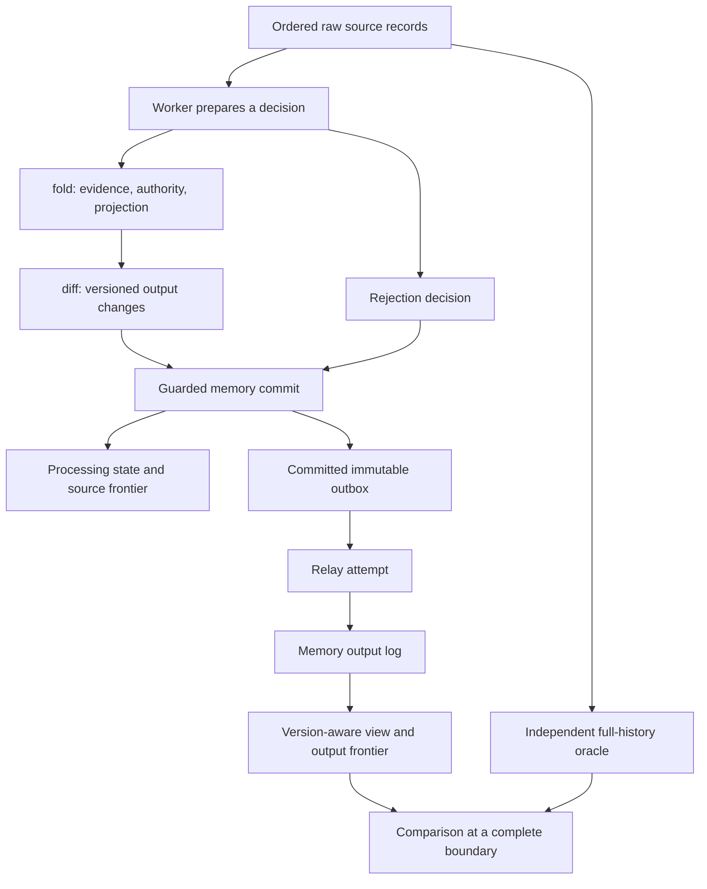
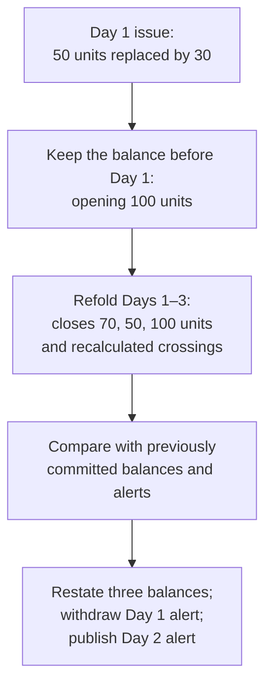
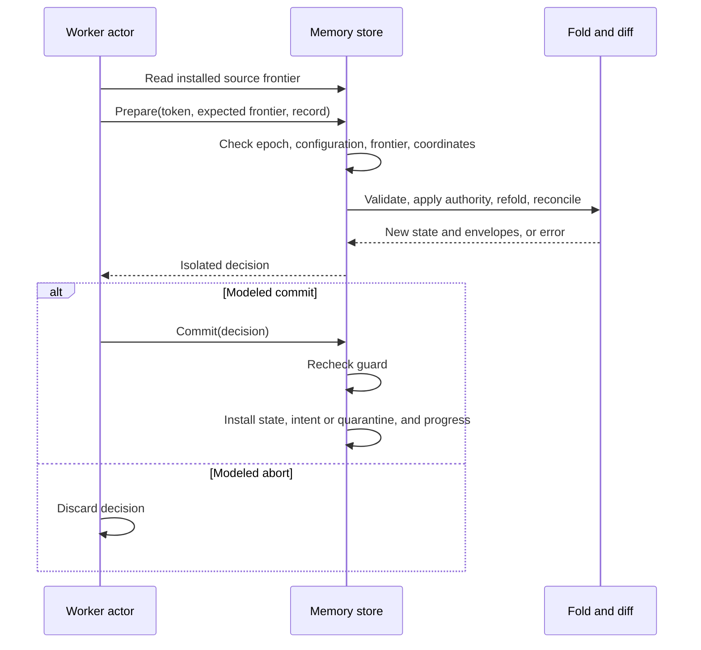

# amends technical guide

Use this guide to follow a correction through the Go code: selecting the applicable source revision, recalculating affected history, publishing changed results, and checking recovery independently. [Design](design.md) explains architectural tradeoffs; [semantics](semantics.md) is normative; [testing](testing.md) maps the named semantic scenarios SC01–SC28 to evidence.

The detailed memory path below makes decisions easy to inspect. A **model commit** installs a prepared value in serial memory; it is not a PostgreSQL transaction. The durable path uses the same calculation and output comparison with actual row locks, SQL transactions, and broker adapters.

## Contents

- [What is built](#what-is-built)
- [Running the implementation](#running-the-implementation)
- [Package structure](#package-structure)
- [The data model](#the-data-model)
- [Decoding and source authority](#decoding-and-source-authority)
- [Incremental balance and alert repair](#incremental-balance-and-alert-repair)
- [Versioned output and materialization](#versioned-output-and-materialization)
- [The memory transaction boundary](#the-memory-transaction-boundary)
- [A correction from input to view](#a-correction-from-input-to-view)
- [The independent oracle](#the-independent-oracle)
- [Scheduling failures and recovery](#scheduling-failures-and-recovery)
- [Verification boundaries and results](#verification-boundaries-and-results)
- [Replay and rebuild](#replay-and-rebuild)
- [Tests and reproducible evidence](#tests-and-reproducible-evidence)
- [Reading and extending the code](#reading-and-extending-the-code)

## What is built

amends maintains derived facts from a synthetic inventory ledger. Each transaction represents a signed stock movement for one item at one location. A later source revision can replace its quantity or effective time, cancel it, or reactivate it. The processor repairs daily balances and historical threshold-crossing alerts when authoritative history changes.

Receipts add inventory and issues remove it. Each activity day's final balance is its **daily close**. An alert records a **downward crossing**: the previous daily close (or opening balance) is at or above the reorder threshold, and the new close is below it. Remaining below the threshold does not generate another alert.

For example, changing a Day 1 issue from 50 units to 30 increases every subsequent balance by 20. With opening inventory of 100 units and a threshold of 60, the first close changes from 50 to 70. The Day 1 alert must be withdrawn; after the Day 2 issue of 20 units, the corrected close of 50 creates a Day 2 alert. Keeping the latest transaction value alone would miss the already-published facts that now need correction.

The highest revision supplies **source authority**: the transaction value the calculation must use. Conflicting values at that revision block the key rather than selecting a lower revision. Normally the processor recalculates from the earliest affected day forward, the **affected suffix**. This is a **refold**; resolving a blocked authority conflict requires refolding the whole key. The **diff** then compares old and new business results to find publications or withdrawals.

Intended publications commit with processing state in an **outbox**, which the relay delivers separately. Consumers store the latest results in a **materialized view**, retaining deletion versions (**tombstones**) against older delayed messages. The durable next offset to process is a **frontier**; workers and the view track different streams. A database ownership generation (**epoch**) prevents old-owner commits after replacement, a protection called **fencing**. A separately implemented full-history calculation (the **oracle**) checks the resulting business state without reusing refold/diff decisions.

The implementation contains:

| Capability | Current implementation |
| --- | --- |
| Source authority | Complete replacements, highest-revision selection, duplicate evidence, cancellations, and explicit conflicts |
| Incremental derivation | Sparse UTC daily balances and daily crossing alerts, repaired from the earliest affected day |
| Output protocol | Stable namespaced identities, per-identity versions, restatements, withdrawals, and READY/BLOCKED status |
| Processing model | Serial partition ownership, prepared decisions, atomic installation of state and progress, and an ordered outbox |
| Downstream model | Retried publication and a view that retains the highest version, including deletion markers |
| Independent computation | Full-history authority reconstruction and exact daily aggregation without calling the incremental implementation |
| Executable evidence | Hand-stated fixtures, named scenarios, generated histories, explicit fault schedules, and saved replay traces |
| Command line | Core demonstration, simulation, source/output provisioning, fixture loading, source/relay/view roles, and live view inspection |

The core and simulator use the Go standard library. The PostgreSQL adapter uses pgx v5.11.0. Source ingestion uses franz-go v1.22.1 and the `bin/amends` worker. The same binary runs source, relay, or view roles; there is no HTTP API. The transport uses the same pinned broker client.

## Running the implementation

Start with `make core-demo`; the [evaluation guide](evaluation.md) adds durable correction and crash recovery. Use `make check` for contributor checks. [Testing](testing.md#commands-by-purpose) lists focused integration/evidence targets, and `make help` / `amendsctl help` list available commands. Go and dependency versions are pinned in [go.mod](https://github.com/sorrell-consulting/amends/blob/main/go.mod).

Runnable Go examples demonstrate [a correction moving an alert](https://github.com/sorrell-consulting/amends/blob/main/internal/fold/example_test.go), [a balance withdrawal](https://github.com/sorrell-consulting/amends/blob/main/internal/diff/example_test.go), and [stale delivery after a withdrawal](https://github.com/sorrell-consulting/amends/blob/main/internal/view/example_test.go). Their expected output is fixed in the source. Run them without services:

```sh
GOWORK=off go test -mod=readonly -run '^Example' ./internal/fold ./internal/diff ./internal/view
```

## Package structure

The code is organized around decisions and their application. Pure computation returns values; stores install the decision under their respective transaction boundary.

| Package or file | Responsibility and useful entry points |
| --- | --- |
| [internal/ledger/types.go](https://github.com/sorrell-consulting/amends/blob/main/internal/ledger/types.go) | Shared schema, cloning, configuration identity, and payload/envelope equality |
| [internal/ledger/wire.go](https://github.com/sorrell-consulting/amends/blob/main/internal/ledger/wire.go) | Strict transaction JSON shape checking through `Decode` |
| [internal/fold/fold.go](https://github.com/sorrell-consulting/amends/blob/main/internal/fold/fold.go) | Input validation, revision evidence, authority, conflict status, and suffix repair through `Validate` and `Apply` |
| [internal/diff/diff.go](https://github.com/sorrell-consulting/amends/blob/main/internal/diff/diff.go) | `Reconcile` converts a projection change into versioned envelopes |
| [internal/store/memory/store.go](https://github.com/sorrell-consulting/amends/blob/main/internal/store/memory/store.go) | Ownership, `Prepare`/`Commit`, snapshots, outbox acknowledgement, and replay checks |
| [internal/broker](https://github.com/sorrell-consulting/amends/tree/main/internal/broker) | Topic identity, retention/boundary checks, source/output manifest, raw-key and output-wire decoding |
| [internal/worker](https://github.com/sorrell-consulting/amends/tree/main/internal/worker) | Guarded assignment, PostgreSQL seeks, serial decisions, bounded retries, and cancellation |
| [internal/verify](https://github.com/sorrell-consulting/amends/tree/main/internal/verify) | Guarded source/output boundary, independent source reconstruction, evidence comparison, and structured statuses |
| [internal/delivery](https://github.com/sorrell-consulting/amends/tree/main/internal/delivery) | Ordered relay steps, durable view consumption, commit observation recovery, and singleton service loops |
| [cmd/amends](https://github.com/sorrell-consulting/amends/tree/main/cmd/amends) | Source, relay, or view process with signal-aware shutdown |
| [internal/store/postgres](https://github.com/sorrell-consulting/amends/tree/main/internal/store/postgres) | Actual row fencing, processing and view transactions, publication receipts, and consistent snapshots |
| [internal/view/view.go](https://github.com/sorrell-consulting/amends/blob/main/internal/view/view.go) | Envelope validation, version-aware `Apply`, and visible `Projection` |
| [internal/oracle/oracle.go](https://github.com/sorrell-consulting/amends/blob/main/internal/oracle/oracle.go) | Independent full-history `Compute` |
| [sim/model.go](https://github.com/sorrell-consulting/amends/blob/main/sim/model.go) | Actors, outcomes, `Step`, `Drain`, complete-boundary `Check`, and administrative `Replay` |
| [sim/safety.go](https://github.com/sorrell-consulting/amends/blob/main/sim/safety.go) | Assertions over committed intent, publication, and processed source prefixes |
| [sim/retry.go](https://github.com/sorrell-consulting/amends/blob/main/sim/retry.go) | Explicit logical-clock retry state |
| [sim/corpus.go](https://github.com/sorrell-consulting/amends/blob/main/sim/corpus.go) | Seeded generation, trace validation/execution, and deletion shrinking |
| [internal/admin](https://github.com/sorrell-consulting/amends/tree/main/internal/admin) | Retained replay preflight and fresh-namespace reconstruction |
| [internal/showcase](https://github.com/sorrell-consulting/amends/tree/main/internal/showcase) | Owned finite pipelines, explicit fault barriers, artifacts, child lifecycle |
| [sim/transport](https://github.com/sorrell-consulting/amends/tree/main/sim/transport) | Production delivery orchestration with memory I/O |
| [sim/ownership](https://github.com/sorrell-consulting/amends/tree/main/sim/ownership) | Production worker lifecycle with memory I/O |
| [internal/demo/demo.go](https://github.com/sorrell-consulting/amends/blob/main/internal/demo/demo.go) | Fixture-driven demonstration and agreement checks |
| [cmd/amendsctl](https://github.com/sorrell-consulting/amends/tree/main/cmd/amendsctl) | Command parsing, trace file I/O, reports, and exit codes |

The following diagram shows the implemented memory path. The arrows represent data flow, not separate deployed processes.



The oracle shares ledger types, configuration helpers, serialization, and wire decoding with the other path. It does not import `fold`, `diff`, the memory store, or the view.

### Following the durable path

1. [Worker lifecycle](https://github.com/sorrell-consulting/amends/blob/main/internal/worker/lifecycle.go) `Assign` obtains a guarded database epoch/frontier and seeks the external coordinate; `Process` handles one record and resolves unknown outcomes. The broker runner supplies actual group callbacks and cancellable contexts.
2. [PostgreSQL processing](https://github.com/sorrell-consulting/amends/blob/main/internal/store/postgres/processing.go) `Store.Process` opens a fenced transaction. `ProcessingTx.Apply` calls fold/diff, persists evidence/projection, output state/immutable outbox, quarantine or processing measurements, and source progress. Commit uncertainty returns to lifecycle recovery; it never implies rollback.
3. [Delivery](https://github.com/sorrell-consulting/amends/tree/main/internal/delivery) uses `Stepper` for ordered pending reads, publication of stored bytes, receipt recovery, and view application. Production loops use real broker/SQL I/O; `sim/transport` supplies controlled effects.
4. [SQL view application](https://github.com/sorrell-consulting/amends/blob/main/internal/store/postgres/view.go) `ApplyViewInput` commits version/tombstone decisions with output progress. Equal-version conflicting content retains a protocol diagnostic without skipping the offending record.
5. [Verification](https://github.com/sorrell-consulting/amends/tree/main/internal/verify) independently scans retained broker source to H, obtains a consistent durable view at O after the stopped-writer handoff, and compares the oracle result. It does not read worker answers as oracle input.

The [storage](postgres-store.md), [source](source-worker.md), [delivery](output-delivery.md), and [verification](verification.md) references own the exact SQL, lifecycle, and operational protocols. Measurements expose last committed work, cumulative counts and the latest 32 samples for inspection; a separate bounded verification establishes agreement.

## The data model

`ledger.TransactionKind`, `KeyStatus`, `OutputFamily`, and `OutputType` name the shared protocol vocabulary. Unknown wire values reach validation so rejection evidence can be retained; these types do not replace boundary checks.

### Namespace and stock configuration

A stock key is the pair `(item, location)`. A transaction identity is `(stock key, txn_id)`: the same transaction ID under another stock key is a different identity. Moving inventory between keys requires separate source assertions; there is no atomic cross-key transfer operation.

`ledger.Config` defines the interpretation of a namespace:

| Field | Meaning |
| --- | --- |
| `SchemaVersion` | Supported input/configuration schema; currently 1 |
| `Namespace` | Identity of this processing and output generation |
| `Source` | Source incarnation string, serialized as `source_incarnation` |
| `Partitions` | Number of modeled source/output partitions |
| `Origin` | Ledger origin; transactions before this instant are rejected |
| `Keys` | Configured stock keys, each with opening balance, reorder threshold, and fixed partition |

Opening balance describes stock immediately before the ledger origin. It is not an event and creates no balance row or alert. Thresholds and partition mappings also remain fixed in namespace configuration throughout transaction processing.

`Config.Validate` rejects unsupported schema, missing namespace/source, invalid partition counts or key mappings, duplicate keys, and an empty key set. `Config.Digest` normalizes the origin to UTC, sorts keys, serializes the configuration, and hashes it with SHA-256. Tokens and traces use the digest to detect incompatible interpretation. It is an identity check, not an authentication mechanism.

The fixture metadata file is not itself the full runtime configuration. `fixtures.Config` loads its schema, origin, and key settings, then supplies the requested namespace, a synthetic source incarnation, and one partition. The generator constructs a separate configuration with three keys and two partitions.

### Source assertions and transport records

A source assertion is a complete `ledger.Transaction`. This is the actual amendment in [correction.jsonl](https://github.com/sorrell-consulting/amends/blob/main/fixtures/correction.jsonl), formatted for readability:

```json
{
  "txn_id": "ISSUE-001",
  "revision": 2,
  "kind": "AMEND",
  "stock_key": {"item": "DEMO-PART", "location": "DEPOT-A"},
  "valid_time": "2026-01-01T12:00:00Z",
  "qty": -30,
  "source_time": "2026-01-04T09:00:00Z"
}
```

`qty` is a signed 64-bit integer: positive means receipt and negative means issue. `valid_time` places the movement in business history. `source_time` is informational and does not choose authority. `revision` is a positive signed 64-bit integer. `kind` is `NEW`, `AMEND`, or `CANCEL`.

`ledger.Record` wraps raw bytes with a transport key and `Coordinates{Source, Partition, Offset}`. The raw bytes are separate from the decoded transaction so malformed input can still be preserved. JSON trace serialization encodes this byte slice as base64; a trace's `value` field is therefore not a nested transaction object.

Broker ingestion also stores `RawKey`, serialized as optional base64 `raw_key`, so an invalid key encoding survives quarantine unchanged. Both raw byte slices are deep-cloned. Memory fixtures may omit this field; it never participates in canonical revision equality. The [source worker guide](source-worker.md#manifest-and-raw-records) explains the broker key encoding and manifest.

Record coordinates describe where delivery occurred. They are not the transaction's identity or authority. A canonical duplicate delivered at another offset is another observation of the same assertion.

### Revision evidence

The memory store has one `fold.State` per configured stock key. Its `Identities` map is keyed by transaction ID. Each `fold.Identity` holds:

- `Highest`: the largest revision observed for that identity.
- `Revisions`: a map from revision number to distinct canonical candidates.
- Within each candidate, a representative transaction and the source coordinates at which that canonical assertion was seen.

Duplicate observations add source references without adding a distinct candidate. Different `SourceTime` values alone do not create separate candidates. Superseded revisions and conflicting candidates remain in memory for diagnostics and replay checks; there is no evidence cleanup policy.

`ledger.Conflict` identifies the stock key, transaction ID, and revision at which distinct candidates exist. Its JSON representation supplies a stable reason reference. A key's current BLOCKED reasons list includes only conflicts at currently highest revisions, while `State.Conflicts` also returns superseded conflicts.

`ledger.Rejection` contains the original raw record and a reason code. Accepted canonical evidence and rejected raw input are distinct forms of evidence.

### Projections and outputs

`ledger.Projection` is a computed business view of one stock key:

| Member | Contents |
| --- | --- |
| `Key` | Stock key |
| `Status` | `READY` or `BLOCKED` |
| `Reasons` | Sorted current conflict references |
| `Balances` | Sparse rows of UTC day and closing balance |
| `Alerts` | Still-valid crossings, with crossing day, threshold, and closing balance |

A projection does not contain output versions. Those belong to the publication protocol, because two delivery schedules can produce the same final business projection through different intermediate revisions.

`ledger.OutputID` is `(namespace, family, stock key, day)`. Families are `balance`, `alert`, and `key-status`; status has no day. The Go struct is directly usable as a map key. Its string representation is a JSON tuple, which avoids collisions when identifiers contain separators such as `/`.

`ledger.Envelope` contains schema version, output ID, output version, message type, payload, and cause. The payload's `Present` flag distinguishes a visible fact from a withdrawal. The cause records the triggering source coordinates, transaction ID, and revision. A cumulative balance may depend on many transactions: its cause attributes the change and is not a complete dependency graph.

### Independent counters and positions

Several integers increase for different reasons. Treating them as interchangeable would change the protocol.

| Value | Scope | What an increase means |
| --- | --- | --- |
| Source revision | One transaction identity | Stronger source authority, whether or not delivered later |
| Source offset and worker `Next` | One source partition | Delivery coordinate and exclusive processed frontier |
| Ownership `Epoch` | One namespace partition | A replacement processing token was installed |
| Outbox `Sequence` | One source partition | Another output envelope was committed |
| Output `Version` | One output ID | That derived fact or trust status changed |
| Output log offset and view `Next` | One output partition | Publication coordinate and exclusive applied frontier |

An outbox retry preserves its sequence and envelope version but can occupy another output log offset. A stale source record can advance the worker frontier without emitting anything. Claiming ownership changes the epoch without changing any business fact.

Both frontiers are exclusive. After consuming source offset 4, worker `Next` is 5. The model permits gaps in source coordinates and processes the supplied records in partition order; an offset is not a count of user records. It assumes the supplied source list is the declared complete visible history. Establishing that assumption against a real broker remains adapter work.

## Decoding and source authority

### Strict input shape

`ledger.Decode` accepts one JSON object and rejects trailing JSON, duplicate member names, unknown fields, missing required fields, and null required fields. It checks nested stock-key members as well as top-level fields. Exact field-name checks reject aliases that Go's usual case-insensitive struct matching might otherwise accept.

Typed decoding rejects fractional or out-of-range integers and invalid timestamp syntax. Both timestamps are normalized to UTC. Decoding establishes shape; the worker and oracle separately apply the business validation rules.

The worker's rejection codes are evaluated in this order:

| Code | Condition |
| --- | --- |
| `MALFORMED` | JSON shape, field type, or timestamp decoding fails |
| `IDENTITY` | Transaction ID, item, or location is empty |
| `REVISION` | Revision is less than 1 |
| `KIND` | Kind is not NEW, AMEND, or CANCEL |
| `CANCEL_QUANTITY` | Cancellation has a nonzero quantity |
| `VALID_TIME` | Normalized valid time is outside the supported calendar range or before the origin |
| `UNKNOWN_KEY` | The envelope's stock key is not configured |
| `KEY_MISMATCH` | Transport key differs from the envelope stock key |
| `ROUTING` | Record partition differs from the configured key partition |

An incompatible source incarnation, invalid processing frontier, ownership fence failure, or arithmetic overflow fails the operation and leaves its input frontier unchanged for recovery. A rejection decision advances progress only when its quarantine evidence is installed in the same model commit.

### Complete replacement authority

NEW and AMEND have the same active upsert interpretation. An amendment supplies the complete value that replaces the previous assertion. Revision 4 can arrive before revisions 1–3, and intermediate revisions need never arrive.

`fold.CanonicalEqual` compares transaction identity, revision, kind, normalized valid instant, and quantity. It excludes source time and transport coordinates. Different kinds or valid instants at the same revision conflict even when they would happen to produce identical daily arithmetic.

The highest revision determines authority:

- One canonical candidate at the highest revision is unambiguous.
- If that candidate is NEW or AMEND, it contributes its full quantity on its valid day.
- If it is CANCEL, the identity is inactive.
- More than one distinct candidate at that revision leaves authority unresolved.

A cancellation must have quantity zero, but it does not create a zero-quantity activity day. It removes the old active contribution regardless of the cancellation's own valid time. Its retained authority prevents a late lower NEW from resurrecting stock. A higher complete active revision can reactivate the identity.

### Conflicts and trust status

A current conflict blocks the entire affected stock key. `fold.Apply` retains the last computed balances and alerts while updating status and reasons to BLOCKED. It continues to retain incoming evidence, including changes for other identities on that key. Other stock keys can still be processed.

The frozen numeric values are not a conflict resolution. Which values were computed before ambiguity became visible can depend on arrival order. Consumers must interpret them with the BLOCKED status.

Every unresolved highest-revision conflict on the key must be resolved before computation resumes. Once that happens, `Apply` refolds the entire key from its opening balance, including records accumulated during the block. Historical conflicts remain diagnostic even after the key returns to READY.

READY means there is no known unresolved authority conflict at the processed prefix. It does not mean the worker or view has caught up. A configured untouched key has an initial logical READY status and no business rows; the first accepted input produces an explicit status envelope.

## Incremental balance and alert repair

### Sparse daily facts

The business projection contains one balance row for each UTC day with at least one active authoritative transaction. Active zero-quantity transactions count as activity; cancellations do not.

For an activity day:

```text
before = opening balance + quantities on earlier activity days
close  = before + quantities on this day
cross  = before >= threshold AND close < threshold
```

A day without activity has no stored row. Its balance is implicit in the previous activity day's close, or in the opening balance. There is no dense calendar expansion or time-driven daily job.

Crossings compare daily closes. An intraday fall followed by same-day recovery need not create a crossing. Closing exactly at the threshold is not below it. Opening below the threshold does not manufacture an initial crossing.

Alerts describe historical crossing facts that remain valid under current authority. A later receipt does not erase an earlier crossing. A correction can invalidate it, change its payload, or move it to another day. Historical days remain revisable.

### Choosing and recomputing the suffix

The suffix begins at the earliest day changed by removing the old transaction contribution or adding its replacement. Earlier results remain valid; their last closing balance supplies the starting point for repair. For the Day 1 correction, that starting point is the opening balance:



This example shows the computation; downstream delivery runs asynchronously on its own schedule. The following steps select the same boundary when the changed day is later in history.

`fold.Apply` clones the previous state before recording new evidence. After resolving authority and trust status, it chooses the repair boundary:

1. Find the previous active contribution for the changed identity, if any.
2. Find the new authoritative active contribution, if any.
3. Use the earlier of their UTC days.
4. If neither contributes, there is no business suffix to refold.

Stale revisions and canonical duplicates normally leave the projection unchanged. Resolving a BLOCKED key overrides the ordinary boundary and refolds everything.

`refold` preserves balance and alert rows strictly before the boundary. It restores the last preceding sparse close, falling back to the opening balance. It then collects current active transactions in the suffix, sorts by valid time and transaction ID, groups them by day, and recomputes closes and crossings.

Moving a transaction from Day 5 to Day 2 requires repair starting at Day 2. Moving it from Day 2 to Day 5 also starts at Day 2, because its old contribution must disappear. Cancelling the last activity on a day removes that day from the new projection; the diff stage turns that absence into an explicit withdrawal.

The transaction-ID tiebreak gives reproducible traversal. Additive daily totals do not depend on within-day transaction order, so that tiebreak is not the source of balance correctness.

### Exact arithmetic and cost

`exactClose` computes the daily close using checked `int64` arithmetic. It separates nonnegative and negative quantities, adds an opposite-signed quantity to the current accumulator when possible, and checks same-sign additions for overflow. This allows representable daily closes even when a naive intraday accumulation order would temporarily overflow. For example, an opening of `MaxInt64` with same-day quantities `+1` and `-1` has a representable final close.

If the exact daily close is outside the signed 64-bit range, the fold returns an error. The prepared decision is not committed and the source frontier does not advance. Counter and output-version exhaustion likewise fail explicitly.

The implementation favors inspection over throughput. A repair clones per-key evidence, scans current identities, and sorts the relevant active transactions. An early correction may repair the entire key. Snapshots clone maps and slices, and simulation safety checks repeatedly scan history. There is no indexed storage engine, checkpoint hierarchy, benchmark claim, or bounded correction-latency guarantee.

The [design discussion](design.md#why-refold-the-suffix) explains why suffix refolding was chosen over specialized delta propagation. Its [2,000-day example](design.md#how-much-history-needs-repair) runs this fold with early and late corrections, distinguishes measured suffix records from total processing cost, and checks balances, alert changes, and a last-day withdrawal independently.

## Versioned output and materialization

### Diffing against committed intent

`diff.Reconcile` compares the new projection with the last committed output state. This state may be ahead of what the relay has published or the view has applied. Diffing against the downstream view would incorrectly mix transport lag into business version allocation.

The function constructs desired balances, alerts, and status, then adds withdrawal payloads for previously present business IDs that have disappeared. It compares semantic payloads, allocates `old.Version + 1` only where a payload changed, and returns all envelopes as one decision.

| Transition | Envelope |
| --- | --- |
| Balance appears or its close changes | `BalanceStated` |
| Activity day disappears | `BalanceRetracted` |
| Crossing appears or its payload changes | `AlertRaised` |
| Crossing disappears | `AlertRetracted` |
| Status or reason set changes | `KeyStatusStated` |

Versioning starts at 1 per output ID. A higher source revision with unchanged daily business facts does not allocate another business version. Changing the informational cause alone does not cause a restatement.

Business changes are ordered by their encoded output IDs; the status ID is processed last. Thus repairs resulting from conflict resolution are enqueued before READY. This ordering is committed in the outbox. Downstream consumers apply individual envelopes and may observe a partial repair until delivery completes.

### Two equality rules

`Payload.Equal` is used when deciding whether a new semantic output is needed. It compares presence, close, threshold, status, and reasons.

`Envelope.Equal` is stricter. It also compares schema, identity, version, message type, and the complete cause. Once an envelope has been committed, a transport retry must preserve that whole envelope. Reusing the same output ID and version with a different cause is a protocol conflict even if the business payload is unchanged.

### View application and deletion guards

`view.State` contains configuration, a map of retained envelopes, per-partition output frontiers, and stopped-partition diagnostics. `Apply` validates routing, namespace, schema, cause, family, type, day, and payload shape before applying the version rule:

| Incoming version | Result |
| --- | --- |
| No stored version, or greater than stored | Store the incoming envelope |
| Equal, with identical complete envelope | Treat as a duplicate |
| Equal, with different content | Record a protocol error and stop the partition |
| Lower, but otherwise valid | Ignore the older state |

Successful application, including ignored older messages and exact duplicates, advances the output frontier to `offset + 1`. A protocol conflict leaves rows and frontier before the offending record. Subsequent application to that stopped partition fails.

A withdrawal stores an envelope with `Present=false`. `Projection` hides that row, but the version remains in `Rows`. If a version-3 withdrawal is followed by a version-2 statement, version 2 cannot resurrect the row. A legitimate reappearance can publish version 4 on the same ID.

There are two separate retained guards: cancellation authority in the source model and deletion versions in the output model. The first defeats stale input; the second defeats stale delivery. Neither has a garbage-collection protocol in this implementation.

The [Idempotent Receiver](https://www.enterpriseintegrationpatterns.com/patterns/messaging/IdempotentReceiver.html) pattern describes safe duplicate handling. [Kafka compaction](https://docs.confluent.io/kafka/design/log_compaction.html#compaction-enables-deletes) uses null-valued broker records as deletion markers, which can expire; amends' deletion guards remain in the view to reject older versions.

The scheduler applies an output to a cloned view and installs the clone only for a modeled committed outcome. The PostgreSQL adapter separately applies the same version decision under a view-progress row lock and commits values, deletion guards, and progress together. Its lost-reply and reconnect tests are described in the [storage guide](postgres-store.md#durable-view).

## The memory transaction boundary

### Stored state

`memory.Store` owns a private snapshot containing:

| State | Purpose |
| --- | --- |
| Configuration | Fixed interpretation of this namespace |
| Partitions | Ownership epoch, exclusive source frontier, and last emission sequence |
| Keys | Revision evidence and latest computed projection per key |
| Outputs | Latest committed envelope per output ID, including withdrawals |
| Outbox | Ordered committed envelopes with acknowledgement flags |
| Rejections | Raw rejected records and exact reasons |

`Snapshot` returns deep copies, including nested evidence, raw rejection bytes, and reason slices. A caller can inspect or modify the returned value without modifying installed store state.

### Prepare and commit

`Claim(partition)` increments the partition epoch and returns a token containing namespace, configuration digest, partition, and epoch. It does not advance input progress.

`Prepare(token, expectedNext, record)` checks that token and frontier against the installed state. It also checks compatible source coordinates. For accepted input, it runs validation, `fold.Apply`, and `diff.Reconcile`, and checks available emission-sequence capacity. For rejected input, it prepares quarantine evidence instead. Neither path changes installed state.

`Commit(decision)` repeats the ownership/configuration/frontier guard. If it succeeds, the serial model installs the new key state or rejection evidence, writes output state and outbox rows where applicable, and advances the source frontier. A stale decision cannot install even part of its result.



A commit reply can be lost after installation. The worker's next attempt rereads the installed frontier rather than assuming the record needs another semantic transition. If the previous operation actually aborted, the same frontier still points to the unprocessed record.

The ownership scenarios exercise both legal serial orders:

- An old decision commits first; a replacement epoch is installed afterward.
- A replacement epoch is installed first; the old prepared decision fails its commit guard.

This model has no mutexes, SQL transactions, row locks, or concurrent-use support. The PostgreSQL adapter implements the fence with actual transactions, and tests both lock orders using independent connections. Broker assignment lifecycle still needs its own guard: an obsolete callback must not acquire a new epoch merely because `Claim` can increment a counter.

### Ordered publication

`Pending(partition)` returns the earliest unacknowledged outbox row for that partition. `Acknowledge` only accepts that pending row's sequence. The relay cannot acknowledge later intent while earlier intent remains pending.

The relay reads a committed envelope and appends a clone to the model's output log when publication is modeled as accepted. Only a known successful acknowledgement marks the outbox row acknowledged. Accepted publication with an unknown reply leaves the row pending; another attempt can append the same envelope again.

Outbox acknowledgement says publication was acknowledged. It does not say the view has applied the envelope. The distinct output-consumer frontier is required to establish downstream completion.

## A correction from input to view

The [core demonstration](https://github.com/sorrell-consulting/amends/blob/main/internal/demo/demo.go) uses one stock key, opening balance 100, and threshold 60. It appends three fixture stages to one model and drains each stage before comparing the view, independent oracle, and hand-stated expected file.

### Initial history

[before.jsonl](https://github.com/sorrell-consulting/amends/blob/main/fixtures/before.jsonl) contains:

| Transaction | Revision | Effective day | Quantity |
| --- | --- | --- | --- |
| ISSUE-001 | 1 | January 1 | -50 |
| ISSUE-002 | 1 | January 2 | -20 |
| RECEIPT-003 | 1 | January 3 | +50 |

End-of-day balances are 50, 30, and 80 units. January 1 crosses from 100 to 50, so it has an alert. January 2 begins below the threshold and creates no new crossing. January 3 recovers above the threshold but does not invalidate the January 1 historical crossing.

Processing these three records commits five output envelopes: three balances, one alert, and the initial READY status. With no publication retries in this demonstration, the source frontier is 3 and the view frontier is 5.

### Quantity amendment

The fourth source record is the revision-2 amendment shown earlier. Its quantity is -30, replacing -50 for ISSUE-001.

The call path is:

```text
Model.Drain
  Model.Step(worker)
    Store.Prepare
      fold.Validate
      fold.Apply
        refold from January 1
      diff.Reconcile
    Store.Commit
  Model.Step(relay), repeated until the outbox is acknowledged
  Model.Step(view), repeated until the output log is consumed
```

The replacement increases each of the three closes by 20:

| Day | Previous close | Corrected close | Crossing after correction |
| --- | --- | --- | --- |
| January 1 | 50 | 70 | None |
| January 2 | 30 | 50 | Downward crossing from 70 to 50 |
| January 3 | 80 | 100 | None |

The committed repair consists of these envelopes in order:

| Envelope | Day | Version |
| --- | --- | --- |
| AlertRetracted | January 1 | 2 |
| AlertRaised | January 2 | 1 |
| BalanceStated | January 1 | 2 |
| BalanceStated | January 2 | 2 |
| BalanceStated | January 3 | 2 |

The key remains READY, so its status does not get another version. Source frontier becomes 4 and output/view frontier becomes 10. The cause of all five repair envelopes is the amendment, although the later balances also depend on the other active transactions.

Between individual view applications, a reader can observe only part of this repair. The demonstration compares after the complete source/output boundary has been reached.

### Cancellation and a disappearing day

[cancel-last-day.jsonl](https://github.com/sorrell-consulting/amends/blob/main/fixtures/cancel-last-day.jsonl) cancels RECEIPT-003 at revision 2. This removes the last active transaction on January 3.

January 3's balance row disappears. It does not become a new explicit row with value 50: the sparse model represents the carried balance implicitly. January 1 and January 2 remain 70 and 50, with the January 2 crossing unchanged.

The only new envelope is `BalanceRetracted` for January 3 at version 3. Source frontier is now 5 and output/view frontier is 11. The view retains the version-3 deletion marker, so redelivery of either earlier January 3 statement cannot restore it.

The withdrawal's envelope represents absence explicitly:

```json
{
  "schema_version": 1,
  "output_id": {
    "namespace": "core-demo",
    "family": "balance",
    "stock_key": {"item": "DEMO-PART", "location": "DEPOT-A"},
    "day": "2026-01-03"
  },
  "version": 3,
  "type": "BalanceRetracted",
  "payload": {"present": false},
  "cause": {
    "source": "synthetic-fixture-v1",
    "partition": 0,
    "offset": 4,
    "txn_id": "RECEIPT-003",
    "revision": 2
  }
}
```

The output version is 3, the triggering transaction revision is 2, and the source offset is 4. Each belongs to a different sequence. A relay retry preserves all of these fields, even when the retry lands at another output-log offset.

The checked-in [transcript](media/core-demo.txt) records these stages. `CORE_AGREEMENT` means fixture, oracle, and memory view agreed; it does not describe a live database/broker verification run.

## The independent oracle

`oracle.Compute(config, history)` receives raw source records and immutable configuration. It does not read the worker's chosen authority, balance state, output versions, or outbox.

Its reconstruction follows a separate route:

1. Check configuration and source-coordinate compatibility.
2. Decode records and independently classify business rejections.
3. Group accepted assertions by stock key and transaction ID.
4. Sort each identity's assertions by revision and examine each revision group for distinct kind, valid time, or quantity.
5. Record conflicts at every affected revision, then select the unique highest active assertion where possible.
6. Mark keys with unresolved highest-revision conflicts BLOCKED.
7. Independently group active movements into UTC calendar days and sum with `math/big.Int`.
8. Compute cumulative daily closes and crossings, rejecting closes outside the `int64` storage domain.

The incremental path retains evidence and repairs a suffix using checked fixed-width arithmetic. The oracle reconstructs authority from the complete supplied history and aggregates whole days using arbitrary-precision arithmetic. This separation gives the comparison a chance to expose defects in either algorithm.

For a BLOCKED key, the oracle reports status and reasons with empty business slices. It cannot derive a uniquely correct numeric projection from conflicting highest authority. Comparison therefore checks trust status and conflict evidence for that key, while numeric equivalence remains required for unblocked keys. This does not turn frozen values into certified values.

Both paths share `ledger.Decode`, configuration validation, and schema. A defect in that shared layer could affect both computations. Dedicated decoder tests and hand-derived fixture expectations supplement the differential comparison. An import-boundary test prevents the oracle from depending on incremental packages, but it is not a formal proof of algorithmic independence.

The full-history oracle compares business facts and diagnostics. It does not generate an expected output version history: intermediate authority and delivery schedules can legitimately yield different publication histories.

## Scheduling failures and recovery

### Actors and outcomes

`sim.Model` holds the source list, processing store, view, per-partition output logs, ownership tokens, logical time, retained-start markers, retry state, and an event log. `Step` advances one explicitly selected actor.

| Actor | Operation |
| --- | --- |
| `worker` | Read current progress, prepare the next record, and optionally commit |
| `relay` | Attempt publication of the earliest pending outbox row |
| `view` | Apply the next output envelope to a cloned view and optionally install it |
| `claim` | Attempt replacement ownership installation |
| `tick` | Advance the logical clock by one |
| `resume-worker`, `resume-relay`, `resume-view` | Reset an exhausted actor's retry state |

The four operation outcomes explicitly separate what happened from what the actor observed:

| Trace outcome | Effect installed or publication accepted | Caller observation | Relay row acknowledged |
| --- | --- | --- | --- |
| `commit` | Yes | Known success | Yes |
| `abort` | No | Known abort | No |
| `unknown-committed` | Yes | Unknown | No |
| `unknown-aborted` | No | Unknown | No |

An event retains the selected step and observed result. Unknown outcomes appear as `unknown` to the modeled actor even though the scheduler knows which effect was installed. This allows tests to distinguish recovery behavior from the test harness's knowledge.

After an unknown worker outcome, the next attempt rereads the source frontier. After an unknown view outcome, its installed frontier determines which output remains to be applied. After an unknown ownership claim, the model forgets the local token and uses `Observe` before further processing. That observation assumes the modeled assignment is still current; it does not implement a real rebalance callback lifecycle.

### Retry time and fair completion

Workers, relays, and views track attempts, next eligible logical tick, and exhaustion per partition. Unsuccessful replies include unknown outcomes even when the operation actually committed. The delays are 1, 2, and 4 logical ticks; the third unsuccessful reply parks the actor until an explicit resume.

Attempts made too early produce a backoff observation. Parked actors do no work. Successful attempts reset retry state. No wall-clock sleeps, random jitter, network deadlines, or real I/O cancellation are involved.

`Drain` supplies an explicit finite recovery suffix. It resumes exhausted actors, honors outstanding backoff, processes remaining source records, acknowledges remaining outbox rows, and applies remaining outputs. It schedules successful operations after faults cease.

This is the liveness assumption behind final convergence tests: a finite history, recoverable failures that end, and enough subsequent execution to finish enabled work. An arbitrary stalled schedule does not converge merely because time passes.

### Safety after steps

`Model.Safety` checks successful scheduled transitions, including idle, backoff, and recovery steps. It checks that:

- Outbox sequences are consecutive per partition and acknowledgements do not skip pending rows.
- Output versions are consecutive per ID in committed intent, and latest output state matches that intent.
- Every published or retained view envelope matches an actual committed outbox envelope exactly.
- The view frontier does not exceed the available output log.
- Worker trust and unblocked business projections agree with an independent oracle over exactly the processed source prefix.
- Quarantine matches the rejected records within that same prefix.

The prefix is constructed using each installed worker frontier. Comparing worker state at that prefix is a step-level safety check. Comparing the downstream view with the entire declared source history requires the separate complete-boundary check below.

## Verification boundaries and results

`Model.Check` is the memory-model comparison. The implemented operational `amendsctl verify` establishes analogous boundaries through broker and PostgreSQL adapters. The model already possesses the declared finite source list and output logs.

For each partition it derives a source end `H` from the last supplied source offset plus one, and an output end `O` from the output log length. Empty partitions have end zero. Before comparing business state, it requires:

1. Compatible model, store, and view configuration digests.
2. The model's required retained source prefix remains available.
3. Worker frontier equals `H`.
4. No pending outbox intent remains.
5. View frontier equals `O`.

The current model assumes a required source start of zero; a positive `Retained[p]` signals that the required prefix is unavailable. It does not interrogate a broker for retention, compaction, topic identity, or a stable end offset.

At a complete boundary, the oracle's projection is compared with the downstream view. Rejections are compared by exact raw record, coordinates, key, and reason, and all conflict references are compared with retained processing evidence. Quarantine is not a blanket permission to ignore discrepancies.

| Status | Meaning in the current model |
| --- | --- |
| `PASS` | Complete boundary, unambiguous authority, no rejection/historical-conflict qualifications, and agreement |
| `PASS_WITH_EXCLUSIONS` | Complete boundary and agreement, with explicitly reported rejected records or historical conflicts |
| `BLOCKED` | Complete boundary, but at least one key has unresolved highest-revision authority |
| `DRIFT` | Complete unblocked comparison found a business, trust, or evidence difference |
| `INCOMPLETE` | Required boundary, configuration compatibility, or retained prefix is unavailable |
| `ERROR` | Oracle computation failed or the view has an output protocol violation |

The current `Check` evaluates the oracle first and reports its errors, then checks view protocol errors and boundary completeness. An incomplete boundary takes precedence over known source conflicts, while keeping those diagnostics in the report. Once the boundary is complete, unresolved authority produces BLOCKED.

At a complete boundary, BLOCKED also takes precedence over a detected difference. The `Difference` field remains populated if another comparison failed, and `sim.Run` rejects such a run. It must not be discarded just because a negative authority status was expected. The report currently carries one difference string rather than a comprehensive row-by-row diff.

`Report.Accepts` accepts strict PASS only with no expected diagnostics. It accepts PASS_WITH_EXCLUSIONS only when explicitly supplied rejection and conflict manifests match exactly. BLOCKED, DRIFT, INCOMPLETE, and ERROR never become verification success. Tests can pass by correctly asserting a negative status, which is different from reporting successful verification.

The [durable verifier](verification.md#how-the-code-establishes-the-boundary) establishes these boundaries through stopped-writer guards, source-incarnation and retention checks, worker progress, publication receipts, output ends, and a consistent SQL view snapshot. Independently operated pipelines require a drained, stopped and joined relay; the owned showcase automates its own handoff. An empty outbox alone cannot establish a complete comparison.

## Replay and rebuild

Three operations use similar language but have different purposes:

| Operation | Current entry point | State and purpose |
| --- | --- | --- |
| Simulation trace replay | `amendsctl sim -replay PATH` | Creates a fresh model and reruns saved source records and explicit schedule choices |
| Consumed-input replay | `amendsctl replay -manifest FILE -partition P -from-offset A -until-offset B`; also `Model.Replay` | Checks an already-consumed retained interval against intact compatible state |
| Namespace rebuild | `amendsctl rebuild -manifest FILE -new-namespace R -output-topic T`; also model SC24 | Reconstructs from sufficient history with separate namespace and output identities |

### Exact trace replay

A `sim.Trace` records generator/trace version, implementation identifier, toolchain string, configuration and digest, seed, raw source records, and explicit steps. Replay uses the saved records and steps; it does not regenerate them from the seed.

The runner checks trace version 1, implementation identifier `core-schedule-v1`, a nonempty recorded toolchain string, and the configuration digest. Other implementation identifiers are rejected. It does not require the recorded toolchain to equal the running compiler. The separate Git revision and worktree metadata in an evidence bundle identify the exact source used for a run.

The CLI rejects unknown trace fields, trailing content, and invalid provenance. It starts decoding into an empty trace, so a partial replay document cannot silently inherit a newly generated history. `sim.Run` follows explicit steps with the implementation's deterministic recovery suffix.

### Replay into intact state

`Model.Replay` accepts the half-open interval `[from, until)` within already-consumed progress. It checks retention, range, and configuration, then preflights the records before claiming an administrative epoch.

For accepted records, `Store.CheckReplay` requires existing canonical candidate evidence with the same source coordinates. For rejected records, it requires the same raw rejection and reason. Reapplying accepted evidence and reconciling output must produce no new envelopes.

This operation preserves the authoritative source frontier, business state, and output versions. It can install a new epoch. It is not a repair mechanism for missing state and does not release quarantine or reinterpret old input.

### Fresh namespace rebuild

The rebuild scenario supplies sufficient source history to a fresh model with a different namespace. It compares resulting business state while allowing a different output version and publication history. Namespaced output IDs keep old output from affecting the fresh view; the original model remains intact.

The [operational replay/rebuild commands](replay-rebuild.md) implement these boundaries against PostgreSQL and Redpanda. They default to dry runs. Rebuild uses the production worker lifecycle, relay, and view and independently verifies the same complete source boundary. The new namespace shares the retained source and source writer guard while using fresh state and output identities. Live consumer cutover and reconstruction from an arbitrary middle offset remain unsupported.

## Tests and reproducible evidence

[Testing](testing.md) owns the complete command matrix, P01–P10 properties, SC01–SC28 mapping, fixed corpora, failure reduction, evidence files, and CI strategy. Read scenario tests alongside the code they constrain. The fixture expectations are hand-derived and checked separately against both computational paths.

Use [delivery simulation](delivery-simulation.md) for production relay/view schedule mechanics, [worker simulation](worker-simulation.md) for assignment/recovery schedules, and [mutation testing](mutation-testing.md) for isolated guard sensitivity checks. Memory schedules do not establish SQL locking or actual group behavior. The [showcase](showcase.md) describes selected real process and administrative fault boundaries.

## Reading and extending the code

A useful reading order is the worked fixture, `ledger` types, `fold.Apply`, `diff.Reconcile`, memory `Prepare`/`Commit`, view `Apply`, oracle `Compute`, then simulator `Step`/`Safety`/`Check`. The scenario tests provide concrete counterexamples alongside each rule.

When inspecting a record's effects, follow the distinct state layers:

1. Its raw source bytes and coordinates explain what was delivered.
2. Candidate evidence explains which revisions and conflicts were observed.
3. The key projection explains computed business facts and trust.
4. Output state and outbox explain which versions were committed for publication.
5. The output log explains deliveries, including duplicate envelopes.
6. View rows and its frontier explain what is currently visible.
7. The oracle report explains whether a complete comparable boundary agrees.

These layers can temporarily differ without a defect: publication or application may lag computation. A complete-boundary comparison is what distinguishes expected lag from disagreement.

For durable changes, also follow the SQL transaction, broker lifecycle, and relay/view handoff. Source/output manifests bind broker incarnations; ownership and progress remain database decisions. Session locks prevent healthy duplicate relay/view starts but cannot fence an in-flight broker request after session loss. The component references above and [worker transaction protocol](design.md#4-worker-transaction-protocol) explain these constraints. Selected real failures and bounded generated schedules are evidence, not a throughput, security, or exhaustive-correctness claim.

Changes to authority, day semantics, output identity, or verification rules should begin with the normative contract and new hand-stated cases. Preserve independent oracle decisions, explicit withdrawals, exact retry envelopes, atomic progress boundaries, and negative result statuses as the implementation grows.
